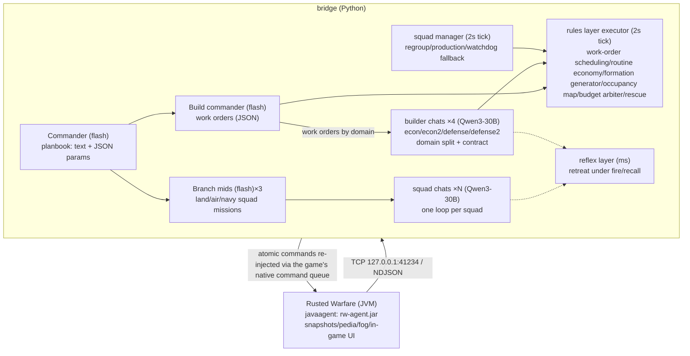

# Rusted Warfare LLM Pilot

[中文](README.md) | **English**

> **Experimental. DO NOT use in multiplayer/online matches.** Automated play violates
> fair-play principles in multiplayer, and the AI's mistakes will drag down your teammates.
> **For single-player research and local reverse-engineering study only. All consequences of misuse are yours.**

A single-player research project that connects Large Language Models to the RTS game
*Rusted Warfare*: it extracts live battlefield state non-invasively, hands decisions to LLMs,
and re-injects commands to drive its own forces.

## What it is

Two parts: a Java javaagent (attached to the game JVM, no game files modified) that uses
bytecode hooks and reflection to extract live battlefield snapshots — units, buildings,
funds, production queues, three-state fog of war, ASCII map, resource points — streamed
over TCP NDJSON every 0.5s; and a Python bridge that distills those snapshots for an LLM
command chain and re-injects commands through the game's native command queue. The data
channel generalizes to other closed-source Java/libGDX games.

The command chain is a layered asynchronous "slow LLM intent, fast deterministic execution"
design: a commander and a build commander (flash) emit JSON planbooks and work orders;
branch mids, squad chats, and builder chats (Qwen3-30B) execute per squad; a rules layer
(2s ticks) and a reflex layer (millisecond) provide the safety net; events decide when to
call the LLM. Fairness by design: only team-vision information is forwarded, commands go
through the normal queue, and everything is rate-limited to human-like APM.

Engineering log and data assets: `PROGRESS.md` (bug history, playtest quotes, baselines)
and `docs/DATASETS.md` (dataset index).

## Current status

- The AI cannot yet reliably beat the highest-difficulty built-in AI; aggression, build
  speed, and multi-front coordination are still being worked out
- The data channel is stable, the four-layer command chain runs on real matches, and
  games are reproducible
- Known issues: upgrade actions that "receipt OK but never land", an extractor
  follow-the-front loop not yet closed, reflection targets pinned to a specific game
  version (a major game update may break them)

## How it works

## Quick start

1. **Build the agent** (JDK 11+): set `GAME_DIR` in `agent/build.sh`, run `bash agent/build.sh`
   → `agent/dist/rw-agent.jar` (the game jar is compile-time only, never bundled)
2. **Configure models**: copy `bridge/secret.toml.example` → `bridge/secret.toml`, add your
   DeepSeek key (or `DEEPSEEK_API_KEY`); tune models/rates/limits in `bridge/config.toml`
3. **Launch the game**: edit paths in `tools/run-with-agent.bat` and run it
4. **Run the bridge**: `python bridge/pilot.py`
   (rule-layer-only, zero tokens: `RW_LLM_MUTE=1 python bridge/pilot.py`)
5. In-game: start a skirmish → click "Delegate all" on the overlay → open
   <http://127.0.0.1:8321> for the dashboard

## Compliance

- **DO NOT use in multiplayer/online matches** (see the warning above)
- Single-player research and reverse-engineering study only; this repo contains no game
  binaries or decompiled artifacts; please support the official game
- Not affiliated with Corroding Games in any way

## License

**Apache License 2.0** — see [LICENSE](LICENSE) and [NOTICE](NOTICE). Derivative works must
preserve attribution and the NOTICE file, and must state changes.
