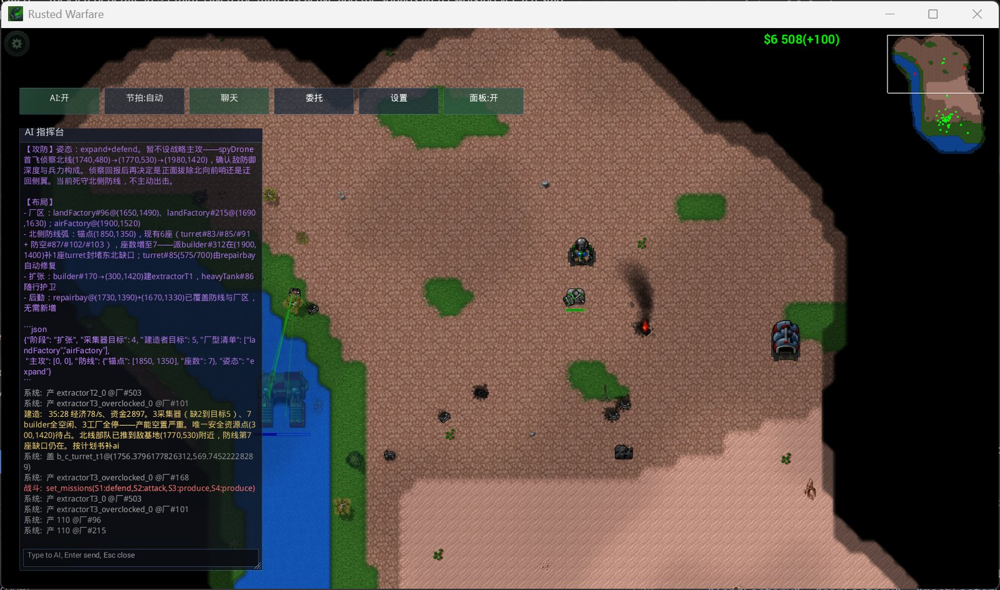
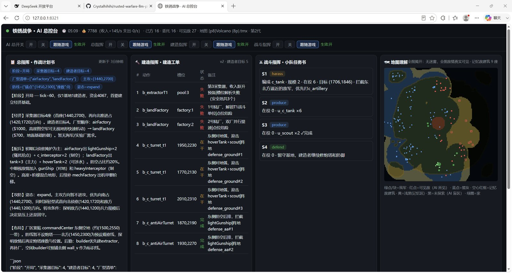
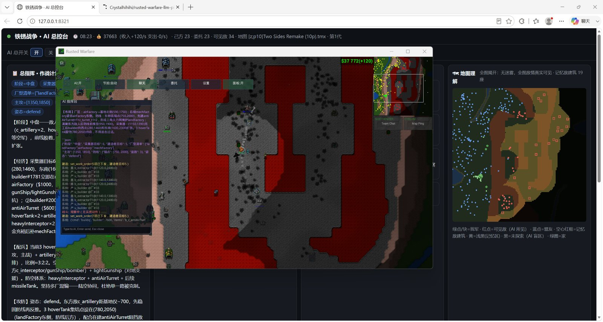
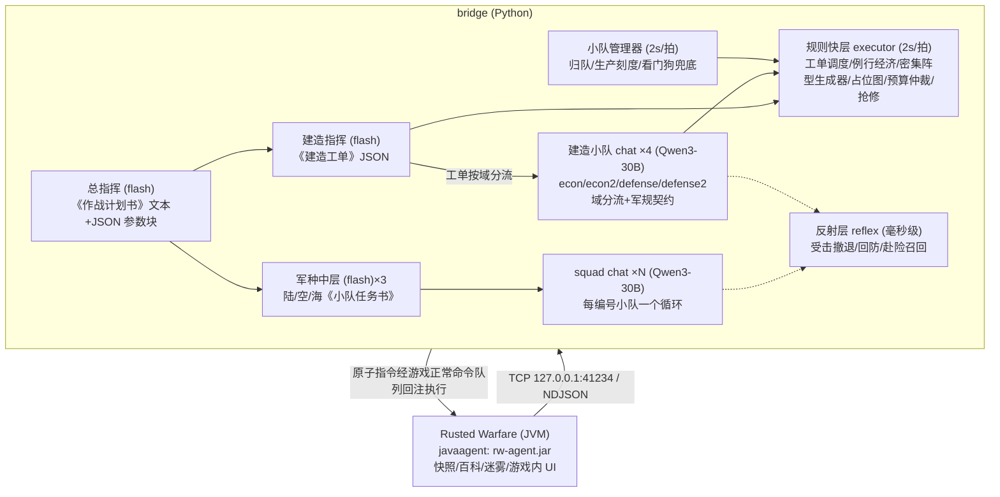

# Rusted Warfare LLM Pilot

**把 LLM 接上《铁锈战争》的战场：无侵入实时取数，LLM 慢思考出意图，确定性层快执行。**

中文 | **[English](README.en.md)**

[实机画面](#实机画面) · [工作原理](#工作原理) · [快速开始](#快速开始) · [合规声明](#合规声明)

*游戏内 overlay：总指挥的攻防姿态与布局判断、下发的 JSON 计划块、规则层事件流实时滚动*

> **实验阶段，严禁用于多人/联机对战。** 自动化操控在多人环境中违反公平竞技原则，
> AI 的失误也会拖累队友。**仅限单机环境与本地逆向工程研究使用，因违规使用造成的一切后果由使用者自负。**

将大语言模型接入即时战略游戏《铁锈战争》（Rusted Warfare）的单机研究项目：
以无侵入方式实时提取战况，交由 LLM 决策，再回注指令指挥自己的部队。

## 项目是什么

两部分组成：一个 Java javaagent（随游戏 JVM 挂载，不改任何游戏文件），通过字节码 hook
与反射实时提取战场快照——单位/建筑/资金/生产队列/战争迷雾三态/ASCII 地图/资源点，
0.5 秒一跳经 TCP NDJSON 输出；一个 Python 桥接层，把快照蒸馏给 LLM 指挥链决策，
指令经游戏原生命令队列回注执行。这套数据通道对 Java/libGDX 闭源游戏可复用。

指挥链是"LLM 慢思考出意图、确定性层快执行"的分层异步结构：总指挥与建造指挥（flash）
出 JSON 计划书与工单，军种中层与 squad chat、建造 chat（Qwen3-30B）分队执行，
规则层（2s/拍）与反射层（毫秒级）兜底，事件决定何时召唤 LLM。公平性设计：
只转发本队视野内信息，指令走正常命令队列，全程限速（拟人 APM）。

工程记录见 `PROGRESS.md`（bug 实录、实测语录、基准数字）。
数据集索引文档（`docs/DATASETS.md`）涉及回放来源信息，按脱敏纪律不公开发布。

## 实机画面

*浏览器总控台（127.0.0.1:8321）：总指挥《作战计划书》、建造工单执行状态、各小队任务书与迷雾三态地图*

*公平性设计可见化：地图理解面板只呈现本队视野内信息，红点为 AI 可见敌情*

## 当前状态

- AI 尚不能稳定战胜最高难度内置 AI，进攻性、建造速度、多线协同仍在打磨
- 数据通道稳定运行，四层指挥链真机运转，对局可复现
- 已知问题：升级动作"回执 ok 不落地"悬案、采集器跟随闭环未完全跑通、
  反射目标按游戏版本写死（游戏大版本更新可能失效）

## 工作原理

## 快速开始

1. **构建 agent**（JDK 11+）：编辑 `agent/build.sh` 的 `GAME_DIR` 后 `bash agent/build.sh`，
   产物 `agent/dist/rw-agent.jar`（游戏 jar 仅编译期引用，不打包）
2. **配置模型**：复制 `bridge/secret.toml.example` 为 `bridge/secret.toml` 填 DeepSeek key
   （或环境变量 `DEEPSEEK_API_KEY`）；`bridge/config.toml` 调模型/节拍/上限
3. **启动游戏**：编辑 `tools/run-with-agent.bat` 的游戏目录后运行
4. **运行桥接**：`python bridge/pilot.py`（静音验证规则层：`RW_LLM_MUTE=1 python bridge/pilot.py`，零 token）
5. 游戏内开遭遇战 → 点 overlay「全队接管」→ 浏览器开 <http://127.0.0.1:8321> 看总控台

## 合规声明

- **严禁用于多人/联机对战**（见顶部警告）
- 仅供单机环境与逆向工程学习研究；仓库不包含游戏本体及任何反编译产物；请支持正版
- 本项目与游戏开发商 Corroding Games 无任何关联

## 开源许可

**Apache License 2.0**（见 [LICENSE](LICENSE) 与 [NOTICE](NOTICE)——衍生作品须保留署名与 NOTICE 内容、须标注修改）。
