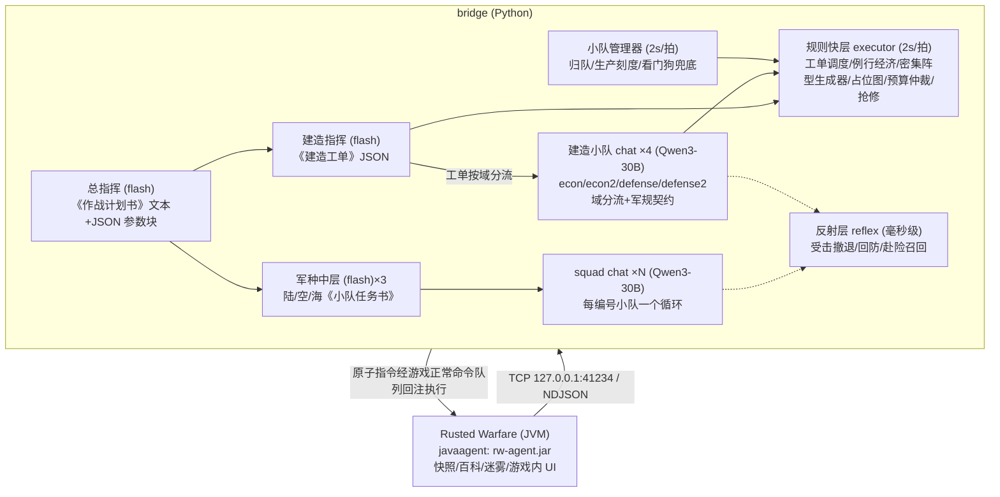

# Rusted Warfare LLM Pilot

中文 | **[English](README.en.md)**

> 当前版本：**v3.2**（参数化指挥链 + 战斗小队多线程：总指挥/建造指挥/战斗指挥出 JSON，squad chat 分队执行）

> ## ⚠️ 严重警告
>
> **本项目处于实验阶段，严禁用于多人/联机对战。** 自动化操控在多人环境中违反
> 公平竞技原则，AI 的失误也会拖累队友。**仅限单机环境与本地逆向工程研究使用，
> 因违规使用造成的一切后果由使用者自负。**
>
> 当前已知限制（v3.2 早期，小队协同仍在快速迭代）：
> - 水图已有基础支持（近水海厂/海军生产/水池采集/进攻水路拆分），特殊开局未充分测试
> - 决策质量取决于所用 LLM，弱模型仍可能给出糟糕的攻防决策

将大语言模型接入即时战略游戏《铁锈战争》（Rusted Warfare）的研究项目：
以无侵入方式实时提取战况，交由 LLM 决策，再回注指令指挥自己的部队。

## 工作原理（分层异步指挥链 v4.x）

- **agent/**：Java `javaagent`，随游戏 JVM 启动挂载（不修改任何游戏文件），周期性输出
  战场快照（己方/盟友/可见敌人、资金、建造进度、生产队列、ASCII 地图与资源点）；
  内置游戏内 UI（AI 聊天台/委托面板/角色设置面板，ASM 按键 hook 实现面板内打字）。
- **bridge/multiagent.py**：参数化指挥链（默认开启，`multi_agent=true`）。总指挥产出持久
  《作战计划书》（文本+JSON 参数块，规则层强制消费）；建造指挥出《建造工单》、战斗指挥出
  《小队任务书》（编号系统校验防混淆）；squad chat 按编号小队驱动（units 限定本队成员）；
  共享状态=快照摘要+计划书参数+小队任务+需求板；回执每拍排空、失败自学习、反射事件回灌。
- **bridge/executor.py**：规则快层与执行内核。例行经济（建造者维持/采集器补池/池点哨戒）、
  防线网格弧（fp 占地表驱动、格距=建筑宽+3 格、防空压后排、主通道留空）、槽位网格
  （厂区贴死密排/后勤成排）、抢修派工、工厂/炮塔升级轨（按厂封禁+可用表学习）；
  `LLM_OFF=1` 时回到全托管基准模式。
- **bridge/pilot.py**：单 LLM 战略层（`multi_agent=false` 时的回退路径）。把战场蒸馏为 12×12 战略格
  + 执行层状态，每 ~25 秒要一个战略动词，翻译为执行层目标或原子指令。
- **bridge/reflex.py**：反射层（分小队）。受击撤退按小队血量独立触发、基地回防只拉守家队（进攻队不动）、
  建造者赴险召回（防线圈 ≤1200px 豁免）。
- **tools/**：分析探针源码与「带 agent 启动游戏」的启动脚本。

公平性设计：只转发本队视野内信息；指令走游戏正常命令队列；全程限速。

## 快速开始

1. **构建 agent**（需要 JDK 11+）：
   编辑 `agent/build.sh` 中的 `GAME_DIR` 指向你的游戏安装目录，然后执行
   `bash agent/build.sh`，产物为 `agent/dist/rw-agent.jar`。
   （游戏 jar 仅编译期引用，不会打包进 agent。）
2. **配置模型**：复制 `bridge/secret.toml.example` 为 `bridge/secret.toml` 并填入
   DeepSeek API Key（或设置环境变量 `DEEPSEEK_API_KEY`）。
   `bridge/config.toml` 可调整 `base_url`、`model`、节拍、APM 上限等参数。
3. **启动游戏**：编辑 `tools/run-with-agent.bat` 中的游戏目录与本项目路径后运行，
   游戏即携带 agent 启动。
4. **运行桥接**：
   - `python bridge/main.py` —— 战况摘要打印（联调验证用）
   - `LLM_OFF=1 python bridge/pilot.py` —— 纯执行层模式（零 token，验证自动运营）
   - `python bridge/pilot.py` —— 完整模式（执行层运营 + 反射层救急 + LLM 战略指挥）

   游戏内需先委托单位：点击 overlay 面板的「全队接管」，或框选单位后点「委托选中」。

## 合规声明

- **严禁用于多人/联机对战**（见顶部警告）：AI 操控存在大量已知缺陷，
  会拖累队友并违反公平竞技原则。
- 本项目仅供**单机环境与逆向工程学习研究**使用。
- 仓库不包含游戏本体及任何反编译产物；请支持正版游戏。
- 本项目与游戏开发商 Corroding Games 无任何关联。

## 开源许可

[MIT](LICENSE)
